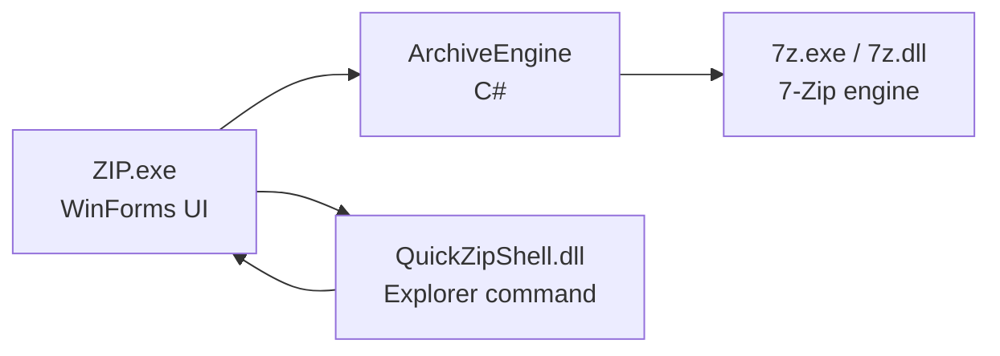

<div align="center">


<h1>ZIP</h1>

<p><b>把压缩包变成顺手的事。</b></p>

<p>Windows x64 原生归档工具 · 右键即用 · 浏览 / 编辑 / 校验一体</p>

[](https://github.com/YYHSSR/Zip)
[](https://dotnet.microsoft.com/)
[](https://github.com/YYHSSR/Zip)
[](https://github.com/YYHSSR/Zip)
[](LICENSE)

[功能](#功能) · [快速开始](#快速开始) · [格式](#支持的格式) · [使用](#使用) · [构建](#构建) · [许可证](#第三方与许可证)

</div>

ZIP 是一个面向 Windows x64 的归档工具。它把右键快速压缩、格式转换、压缩包浏览与编辑放进同一个轻量界面，底层使用 7-Zip 引擎，因此能处理 Windows 和 Linux 上常见的归档格式。

目标很简单：**常用的压缩、解压、查看和修改，不用来回换工具。**

## 功能

|  |  |
|:---|:---|
| **🖱️ 右键即用**<br><br>资源管理器右键直接压缩为 ZIP / 7z，或解压到此处、同名文件夹、其他文件夹。Windows 11 从「显示更多选项」进入。 | **🗂️ 格式覆盖**<br><br>创建 ZIP、7z、TAR 及压缩 TAR；读取 RAR、ISO、WIM、CAB、DEB、RPM 等常见格式；单文件还可创建 gzip、xz、bzip2。 |
| **✏️ 浏览与编辑**<br><br>像文件管理器一样浏览压缩包；ZIP、7z、TAR、WIM 支持添加、删除、重命名，外部修改后还能提示写回。 | **🧠 智能解压**<br><br>只有一个顶层项目时自动去掉多余的一层文件夹；默认开启，可在设置中关闭。 |
| **🪟 多窗口与批量**<br><br>多个压缩包在同一进程内各占一个窗口；重复打开会切换窗口；多选压缩包解压时共用一个进度窗口，并优先尝试上次成功的密码。 | **⚡ 流处理与性能**<br><br>TAR 系列尽量流式处理；浏览、提取所选和保留下载安全标记时按需使用临时文件，避免无谓地整包展开。 |
| **🔐 密码与安全**<br><br>密码只保留在当前归档窗口，调用引擎时通过短生命周期进程参数传递；AES ZIP 使用可打印 ASCII 密码，中文密码建议使用 7z。 | **🎨 原生轻量**<br><br>WinForms 原生界面，高 DPI；不安装后台服务，不包含账号系统或遥测，文件关联与右键菜单可随时移除。 |

## 贡献者

| 贡献者 | 角色 |
|:---|:---|
| [YYHSSR](https://github.com/YYHSSR) | 作者 · 维护者 |
| [Claude](https://github.com/claude)（Anthropic） | AI 开发协作 |
| [ChatGPT / Codex](https://github.com/codex)（OpenAI） | AI 开发协作 |

> AI 工具仅作为开发协作被致谢，不作为著作权主体。归档引擎来自 Igor Pavlov 的 7-Zip，详见[第三方与许可证](#第三方与许可证)。

## 快速开始

### 便携版

从 [Releases](https://github.com/YYHSSR/Zip/releases) 获取 `ZIP-win-x64.zip`，或按[构建](#构建)自行生成，然后解压到固定目录，双击 `ZIP.exe`。需要安装 **Microsoft .NET 10 Desktop Runtime x64**。

### 右键菜单

运行 `Enable-Context-Menu.cmd`，为当前 Windows 账户注册压缩 / 解压菜单。Windows 11 需要从「显示更多选项」进入。

移动或删除程序目录前，先运行 `Disable-Context-Menu.cmd` 移除注册，避免右键菜单指向不存在的程序。

### Windows 11 MSIX 测试包

`ZIP-win11-x64.msix` 是本机测试包。将安装文件和包放在同一目录，运行 `Install-ZIP.cmd`；或在管理员 PowerShell 中运行：

```powershell
Add-AppxPackage -Path .\ZIP-win11-x64.msix -AllowUnsigned
```

含可执行内容的未签名测试包需要管理员安装，详见[微软文档](https://learn.microsoft.com/en-us/windows/msix/package/unsigned-package)。安装后可在「设置 → 应用 → 已安装的应用」卸载。

### 设为默认压缩软件

右键菜单和双击打开可以任选一种方式注册。之后在主窗口「⋯ → 设为默认压缩软件」，或运行：

```powershell
ZIP.exe --set-default
```

Windows 会跳到 ZIP 的默认应用设置页，需要你点「设置默认值」。Windows 10/11 不允许应用静默修改默认程序，这一步必须由用户确认。

也可以用 `ZIP.exe --associate` / `--unassociate` 单独注册或移除文件关联。

### 运行要求

| 项目 | 要求 |
|:---|:---|
| 系统 | Windows 10/11 x64 |
| 运行时 | .NET 10 Desktop Runtime x64 |
| 权限 | 便携版普通用户即可；MSIX 未签名测试包需要管理员安装 |
| 引擎 | 发布包内附带 7-Zip 26.06 的 `7z.exe` / `7z.dll`，无需另行安装 |
| 数据 | 设置保存在 `%LOCALAPPDATA%\ZIP\settings.json` |

## 支持的格式

| 操作 | 格式 |
|:---|:---|
| **创建** | ZIP、7z、TAR、TAR.GZ、TAR.XZ、TAR.BZ2；单文件 gzip、xz、bzip2 |
| **读取** | ZIP、7z、RAR / RAR5、TAR、TGZ、TXZ、TBZ2、TAR.ZST、GZ、XZ、BZ2、ZST、ISO、CAB、WIM、DEB、RPM |
| **编辑** | ZIP、7z、TAR、WIM |
| **只读** | RAR / RAR5、ISO、压缩的 TAR、分卷及其他不支持原地修改的格式 |

分卷压缩包需要放在同一目录，打开入口文件即可，例如 `name.7z.001` 或 `name.part01.rar`。

## 使用

### 右键菜单

- 普通文件或文件夹：**压缩为 ZIP**、**压缩为 7z**、**压缩为其他格式**。前两项使用较低压缩级别；第三项打开格式、压缩级别和保存位置设置。
- 压缩包：**解压到此处**、**解压到同名文件夹**、**解压到其他文件夹**、**用 ZIP 打开**。
- 多选文件或文件夹时，右键菜单会按当前选择批量处理。

### 浏览与编辑

- 双击列表中的文件：解压到临时目录并用系统默认程序打开；可执行文件会先确认。右键可选择「打开方式…」。
- ZIP、7z、TAR、WIM 在外部程序中保存修改后，ZIP 会询问是否更新到压缩包。
- 「添加」或把文件拖进列表，会加到当前文件夹；`Delete` 删除，`F2` 重命名。
- RAR、ISO、压缩的 TAR、分卷等格式只读。
- 加密 7z 的文件名加密在编辑后保留。
- 地址栏每一级都可点击跳转；`Alt + ↑` 返回上一级；`Ctrl + F` 搜索整个压缩包。
- 列表支持按列排序、选中后解压、拖出、完整性校验；打开 ZIP 时可切换文件名编码。
- 「解压」按钮的下拉菜单提供「解压到当前文件夹」和「解压到同名文件夹」。

### 设置

「⋯ → 设置」可调整：

- 智能解压（只有一个顶层项目时不再多套一层文件夹，默认开启）
- 解压后打开文件夹
- 默认压缩级别
- 打开程序前确认
- 写回提示

设置保存在 `%LOCALAPPDATA%\ZIP\settings.json`。

### 密码与安全

- 密码只保留在当前归档窗口内，调用引擎时以短生命周期的进程参数传递。
- 创建 AES ZIP 使用可打印 ASCII 密码；需要中文密码时选择 7z。
- 提取到已有目录时，遇到同名顶层文件或目录可以选择保留两份或跳过。
- 解压前建议先看清目标目录，避免覆盖已有文件。

## 构建

安装 **.NET 10 SDK** 和 **MinGW-w64 x64** 工具链。引擎目录需要放入同一版正式 7-Zip Windows x64 的 `7z.exe`、`7z.dll` 和 `License.txt`。

```powershell
powershell.exe -NoProfile -ExecutionPolicy Bypass -File .\scripts\Build.ps1 `
  -EngineDirectory 'C:\Program Files\7-Zip' `
  -Compiler 'E:\msys2\ucrt64\bin\g++.exe'
```

| 参数 | 作用 |
|:---|:---|
| `-EngineDirectory` | 7-Zip 引擎目录，需包含 `7z.exe`、`7z.dll`、`License.txt` |
| `-Compiler` | MinGW-w64 x64 的 `g++.exe`，用于编译资源管理器右键扩展 |
| `-MakeAppx` | 指定 Windows SDK 的 `MakeAppx.exe`，启用 MSIX 打包 |
| `-OutputDirectory` | 输出目录，默认 `dist` |
| `-Version` | 覆盖版本号，默认读取项目文件 |
| `-SignTool` / `-SigningCertificateThumbprint` / `-TimestampUrl` | 可选：为 MSIX 签名并时间戳 |

构建产物默认位于 `dist/`：

- `ZIP-win-x64.zip`：便携版
- `ZIP-win11-x64.msix`：MSIX 测试包（使用 `-MakeAppx` 时）
- `ZIP/`：未打包的便携目录

主程序目标框架为 .NET 10，资源管理器扩展由 `shell/ExplorerCommand.cpp` 编译为 `QuickZipShell.dll`。所有 .NET 依赖随发布目录提供，开发工具不需要分发给最终用户。

## 架构



| 路径 | 内容 |
|:---|:---|
| `src/` | C# WinForms 主程序、归档引擎、设置、文件关联、单实例逻辑 |
| `shell/` | 资源管理器右键扩展与 MSIX 清单 |
| `scripts/` | 构建、右键菜单注册、图标与资源生成 |
| `assets/` | 图标源文件 |
| `dist/` | 构建输出（已忽略，不提交） |
| `README.md` / `LICENSE` | 文档与许可 |

## 第三方与许可证

ZIP 的原创代码、文档、脚本、界面设计和图标采用 **ZIP 非商业共享许可证 1.0（ZNCSL-1.0）**。它允许非商业使用、修改和二次创作，但禁止商业使用，并要求署名和相同方式共享。

这是源码公开的非商业共享许可证，**不是 OSI 认可的开源许可证**；源码公开是为了方便审阅、学习与非商业二创，不改变许可证对商业使用的限制。

| 内容 | 适用协议 |
|:---|:---|
| ZIP 原创代码、文档、脚本、界面与图标 | [ZIP 非商业共享许可证 1.0](LICENSE) |
| 7-Zip 引擎（`7z.exe` / `7z.dll`） | 随附 `License.txt` 中的 GNU LGPL、BSD 与 unRAR 条款 |
| .NET 10 | MIT License |
| Microsoft Windows / MSIX 组件 | Microsoft 适用条款 |

- 7-Zip 26.06 由 **Igor Pavlov** 开发，发布包中应保留其 `License.txt`。引擎可以替换为兼容的新版 7-Zip。
- 本许可证不覆盖 7-Zip、.NET 或 Microsoft 组件，也不对它们重新授权。
- 商业使用需同时获得 YYHSSR 与相关第三方权利人的许可；**YYHSSR 无权就 7-Zip 等第三方内容授予商业许可**。

### 你可以 / 你必须 / 你不可以

| 你可以 | 你必须 | 你不可以 |
|:---|:---|:---|
| 个人使用、学习、研究、教学 | 保留版权声明与许可证 | 出售、出租、付费分发 |
| Fork、修改、二次创作 | 显著注明来源与作者 | 用于商业产品或商业服务 |
| 非商业转发原版或二创 | 二创继续使用同一许可证 | 设置付费墙或捆绑销售 |
| 分享给朋友 | 标注修改内容与日期 | 暗示作者为你背书 |

### 转发 / 二创署名模板

```text
本项目基于 YYHSSR/ZIP（https://github.com/YYHSSR/Zip）修改。
原项目采用 ZIP 非商业共享许可证 1.0（ZNCSL-1.0）。
修改内容：……
修改日期：……
```

完整条款见 [LICENSE](LICENSE)。如需商业授权，请通过 GitHub 联系 [@YYHSSR](https://github.com/YYHSSR)。

## 免责声明

归档操作可能覆盖、修改或删除文件。请在操作前备份重要数据，并先在测试副本上验证压缩 / 解压流程。

本项目不是 7-Zip、Microsoft 或任何第三方公司的官方产品，也未获得其认可或背书。软件按“现状”提供，不附带任何明示或暗示的担保。

---

<div align="center">

如果 ZIP 让你少装一个压缩软件，点个 ⭐ 支持一下。

Made with care by [YYHSSR](https://github.com/YYHSSR)

</div>
